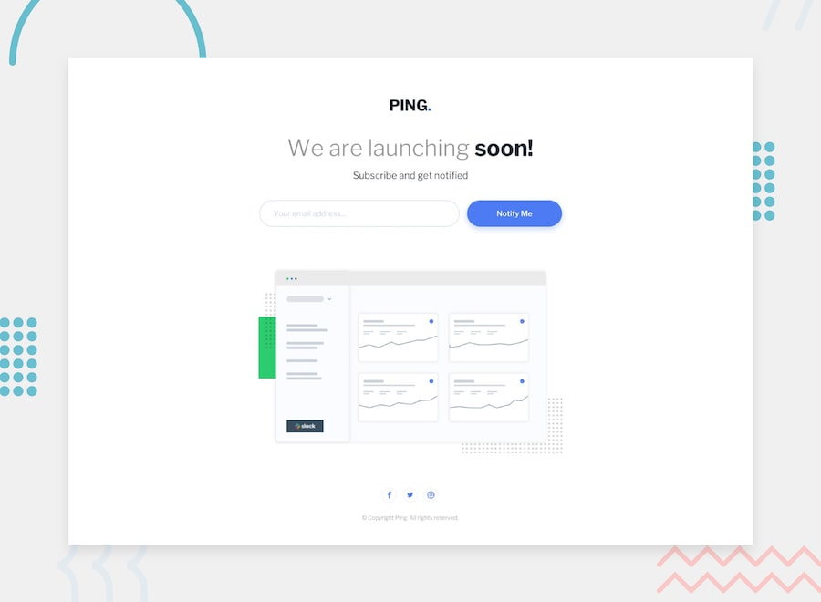

# Ping Coming Soon Page

A responsive coming soon page with email subscription functionality, built as a solution to the Frontend Mentor challenge.




## 🎯 Overview

This project is a pixel-perfect implementation of a coming soon page for "Ping," featuring a clean, modern design with email subscription functionality. The page is fully responsive and includes comprehensive form validation with user-friendly error messaging.

### The Challenge

Users should be able to:

- ✅ View the optimal layout for the site depending on their device's screen size
- ✅ See hover states for all interactive elements on the page
- ✅ Submit their email address using an input field
- ✅ Receive appropriate error messages when the form is submitted if:
  - The input field is empty: *"Whoops! It looks like you forgot to add your email"*
  - The email address is not formatted correctly: *"Please provide a valid email address"*

## ✨ Features

- **Responsive Design**: Optimized for mobile (375px) and desktop (1440px) viewports
- **Email Validation**: Real-time form validation with regex pattern matching
- **Interactive Elements**: Smooth hover effects and transitions
- **Accessibility**: Semantic HTML structure with proper ARIA labels
- **Modern CSS**: CSS custom properties, Flexbox layout, and smooth animations
- **Cross-browser Compatibility**: Tested across modern browsers
- **Performance Optimized**: Minimal dependencies and optimized assets

## 🛠 Technologies Used

- **HTML5**: Semantic markup structure
- **CSS3**: Custom properties, Flexbox, responsive design
- **Vanilla JavaScript**: Form validation and DOM manipulation
- **Google Fonts**: Libre Franklin typography
- **Font Awesome**: Social media icons
- **Git**: Version control

## 🚀 Getting Started

### Prerequisites

- A modern web browser
- Basic understanding of HTML, CSS, and JavaScript

### Installation

1. Clone the repository:
   ```bash
   git clone https://github.com/Ayokanmi-Adejola/Ping-Single-Column-Coming-Soon-Page
   ```

2. Navigate to the project directory:
   ```bash
   cd ping-coming-soon-page
   ```

3. Open `index.html` in your preferred browser or use a local server:
   ```bash
   # Using Python
   python -m http.server 8000

   # Using Node.js
   npx serve .
   ```

4. Visit `http://localhost:8000` to view the project

## 📁 Project Structure

```
ping-coming-soon-page/
├── index.html              # Main HTML file
├── images/                 # Image assets
│   ├── favicon-32x32.png
│   ├── illustration-dashboard.png
│   └── logo.svg
├── design/                 # Design reference files
│   ├── desktop-design.jpg
│   ├── desktop-hover-error-states.jpg
│   ├── mobile-design.jpg
│   └── mobile-error-state.jpg
├── style-guide.md          # Design specifications
├── preview.jpg             # Project preview image
└── README.md              # Project documentation
```

## 🎨 Design Specifications

### Color Palette
- **Primary Blue**: `hsl(223, 87%, 63%)`
- **Light Blue**: `hsl(223, 100%, 88%)`
- **Error Red**: `hsl(354, 100%, 66%)`
- **Gray**: `hsl(0, 0%, 59%)`
- **Dark Blue**: `hsl(209, 33%, 12%)`

### Typography
- **Font Family**: Libre Franklin
- **Weights**: 300 (Light), 600 (Semi-bold), 700 (Bold)
- **Base Font Size**: 20px

### Breakpoints
- **Mobile**: 375px
- **Desktop**: 1440px

## 💻 Development Process

### 1. Planning & Analysis
- Analyzed design files and requirements
- Identified key components and interactions
- Planned responsive breakpoints and layout strategy

### 2. HTML Structure
- Created semantic HTML markup
- Implemented proper form structure with validation attributes
- Added accessibility considerations (ARIA labels, alt text)

### 3. CSS Styling
- Implemented mobile-first responsive design
- Used CSS custom properties for consistent theming
- Created smooth transitions and hover effects
- Ensured cross-browser compatibility

### 4. JavaScript Functionality
- Implemented real-time email validation
- Added error state management
- Created smooth user experience with visual feedback

### 5. Testing & Optimization
- Tested across multiple devices and browsers
- Validated HTML and CSS
- Optimized performance and accessibility

## 🎓 Key Learnings

- **Form Validation**: Implemented comprehensive client-side validation with regex patterns
- **CSS Custom Properties**: Leveraged CSS variables for maintainable theming
- **Responsive Design**: Mastered mobile-first approach with Flexbox
- **User Experience**: Created intuitive error states and feedback mechanisms
- **Performance**: Optimized loading with efficient CSS and minimal JavaScript

## 🔮 Future Enhancements

- [ ] Backend integration for email collection
- [ ] Email service integration (Mailchimp, ConvertKit)
- [ ] Analytics tracking for conversion rates
- [ ] A/B testing for different messaging
- [ ] Progressive Web App (PWA) features
- [ ] Dark mode support
- [ ] Internationalization (i18n) support
